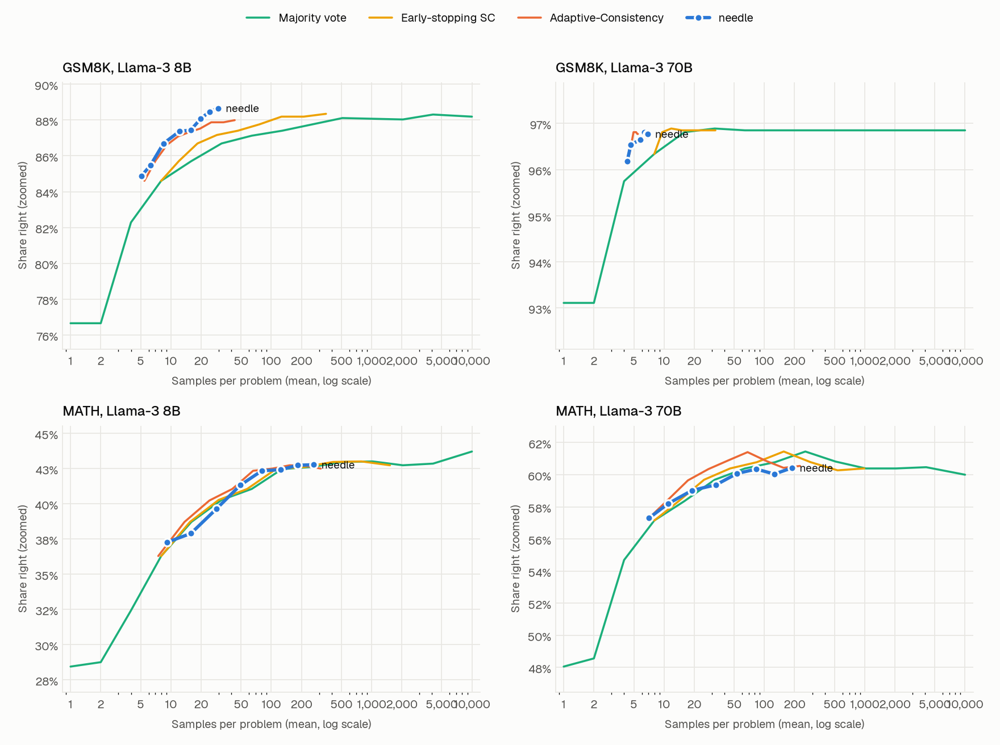
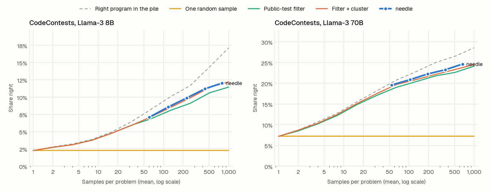
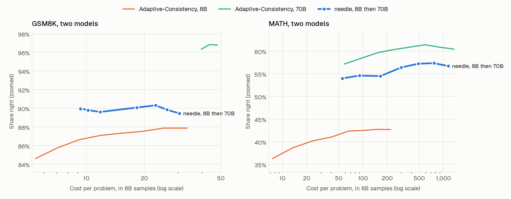

# needle

Ask a model the same question many times and the right answer is usually somewhere in the pile. The hard part is picking it out, and the best way to pick depends on the problem. needle picks the way for you.

Give it a prompt and a model. It works out what kind of problem it is and how hard, runs the sampling strategy that fits, judges the result with a small trained model, and fixes what it can. You never choose a strategy, a sample count or a stopping rule.

<picture>
  <source media="(prefers-color-scheme: dark)" srcset="bench/charts/answers-dark.png">
  
</picture>

## How it works

```
prompt
  │  cache      seen this exact prompt before? reuse the answer
  │  1 classify code (you gave tests), checked (you gave a checker),
  │             answer (it wants one final answer), open (free text)
  │  2 probe    a few samples: how often does one sample agree with the others?
  │             that sets the level: easy, medium, hard or extreme
  │  3 route    look up the registry row for that kind and level:
  │             strategy, batch, budget, stop rule, and what normal looks like
  │    run      vote, test and cluster, first pass, or most typical text
  │  4 check    a small trained model: is the leader right? flag what looks off
  │  5 fix      one remedy per flag: read silent samples as free text, stop trusting
  ▼             passes that fail a rerun, draw more samples, or move up to a stronger model
result: answer, confidence, samples spent, cost, flags, fixes
```

Steps 1, 2, 3 and 5 are fixed rules: given the same samples and test verdicts, needle makes the same choices. Step 4 is a logistic regression over a dozen facts about how the samples came out (how big the leading group is, how far ahead it is, how many samples state an answer, how many get their own arithmetic wrong). It runs in microseconds.

## Results

Measured by replaying the public samples behind [Large Language Monkeys](https://arxiv.org/abs/2407.21787), the paper in the CS329A lecture: Llama-3 8B and 70B, 10,000 samples per problem on GSM8K and MATH, 1,000 per problem on CodeContests (public tests run here, hidden verdicts from the dataset). Every method sees the same sample orders, 20 shuffles per problem (12 for code). The checker is trained on half the problems and scored on the other half, both ways round.

<!-- results:start -->
Budget 1 (the default). Problem counts in brackets. Intervals come from resampling problems.

**Answers.** No checker exists, so samples vote.

| Problems, model | needle | Adaptive-Consistency, same samples | Difference, points (95% interval) | Majority vote, 10,000 samples |
|---|---|---|---|---|
| GSM8K, 8B (127) | 87.4% with 12 samples | 87.1% | +0.2 (-0.8 to +1.7) | 88.2% |
| GSM8K, 70B (127) | 96.7% with 6 samples | 96.8% | -0.1 (-0.4 to +0.1) | 96.9% |
| MATH, 8B (128) | 41.3% with 49 samples | 41.6% | -0.2 (-1.5 to +1.0) | 43.7% |
| MATH, 70B (128) | 59.4% with 33 samples | 60.6% | -1.2 (-2.7 to +0.1) | 60.0% |

**Code.** Public tests are the checker; hidden tests decide right or wrong.

| Problems, model | needle | Filter + cluster, same samples | Difference, points (95% interval) | Right program in the pile, same samples |
|---|---|---|---|---|
| CodeContests, 8B (140) | 12.0% with 786 samples | 11.9% | +0.1 (-0.5 to +0.7) | 16.2% |
| CodeContests, 70B (140) | 24.6% with 664 samples | 23.8% | +0.8 (+0.1 to +1.9) | 27.3% |

**The half never used for tuning.** Registry rows and two answer rules were picked by looking at the other half (fold 0) of GSM8K 8B, MATH 8B and both CodeContests models. This half was not looked at.

| Problems, model | needle | Best rival, same samples | Difference, points (95% interval) |
|---|---|---|---|
| GSM8K, 8B (69) | 85.6% with 12 samples | 84.9% (Adaptive-Consistency) | +0.7 (-1.0 to +3.2) |
| GSM8K, 70B (69) | 95.4% with 6 samples | 95.7% (Adaptive-Consistency) | -0.2 (-0.7 to +0.1) |
| MATH, 8B (65) | 45.4% with 50 samples | 45.8% (Adaptive-Consistency) | -0.4 (-1.9 to +0.9) |
| MATH, 70B (65) | 60.5% with 34 samples | 61.5% (Adaptive-Consistency) | -1.0 (-2.5 to +0.4) |
| CodeContests, 8B (74) | 6.8% with 819 samples | 6.4% (filter + cluster) | +0.3 (-0.0 to +0.9) |
| CodeContests, 70B (74) | 18.9% with 729 samples | 18.5% (filter + cluster) | +0.4 (-0.1 to +1.2) |

**What the flags are worth.**

| Problems, model | Answers flagged | Right when not flagged | Right when flagged |
|---|---|---|---|
| GSM8K, 8B | 8.9% | 90.8% | 52.4% |
| GSM8K, 70B | 2.0% | 97.1% | 74.0% |
| MATH, 8B | 65.2% | 72.8% | 24.5% |
| MATH, 70B | 39.6% | 80.3% | 27.4% |
| CodeContests, 8B | 96.5% | 74.1% | 9.8% |
| CodeContests, 70B | 86.5% | 74.4% | 16.9% |

Checker AUROC (how well its confidence separates right from wrong) on problems it never saw: answers 0.88 to 0.90, code 0.66 to 0.73.

**Two models, cheapest first.** Cost in 8B samples; one 70B sample costs 70/8.

| Problems | needle, 8B then 70B | Moved up to 70B | 8B alone, best | 70B alone, cheapest point |
|---|---|---|---|---|
| GSM8K (127) | 90.1% at cost 18 | 8.3% | 87.9% | 96.3% at cost 40 |
| MATH (128) | 56.4% at cost 300 | 64.6% | 42.7% | 57.1% at cost 58 |
<!-- results:end -->

How to read it:

- **One setup, level with the best method for each task.** Against Adaptive-Consistency on answers and AlphaCode-style filter and cluster on code, every difference at the default budget is within about a point, and you never pick a method.
- **Ahead where it can check its work.** On CodeContests 70B, needle beats filter and cluster by 0.8 points at the same number of samples (interval +0.1 to +1.9), the same accuracy for roughly a third fewer samples. On GSM8K 8B, where needle re-does the arithmetic written in each sample, its curve sits above every rival at every budget and reaches the accuracy of a 10,000-sample vote with about 24 samples. At any single budget that lead is inside its interval.
- **Behind on MATH 70B**, by 1.2 points (interval -2.7 to +0.1). It is the one configuration that leans the wrong way.
- **Where no check exists, nothing closes the gap.** On MATH the right answer is in the pile 98% of the time at 10,000 samples, and voting finds it 44% (8B) to 60% (70B). No way of picking among samples gets past that without a real checker. needle does not invent one. It tells you which answers to doubt instead: on MATH 8B, unflagged answers are right 73% of the time and flagged ones 25%.
- **Cheapest first pays only when the cheap model is usually right.** On GSM8K the ladder answers 90% at cost 18, between the 8B alone (88% at best) and the 70B alone (96% at cost 40). On MATH the 8B model is too often confidently wrong, and the 70B alone is the better buy at every cost measured.

<picture>
  <source media="(prefers-color-scheme: dark)" srcset="bench/charts/code-dark.png">
  
</picture>

<picture>
  <source media="(prefers-color-scheme: dark)" srcset="bench/charts/ladder-dark.png">
  
</picture>

## Use cases

- **Offline jobs where being right beats being fast.** The lecture's "$1k per problem, could be offline" setup: code with tests, questions with one answer, proofs with a checker. needle spends where the problem is hard and stops where it is easy.
- **Training data.** Synthetic data or RL rollouts at scale: keep what passes, with a confidence on every kept answer and a flag on the doubtful ones.
- **Evals.** One setup for every task type, at the accuracy of the best per-task method.
- **Knowing when not to trust an answer.** Route flagged answers to a person, a stronger model or a retry instead of shipping them.
- **Cheap model first, when the cheap model is usually right.** Answer with a small model and send only the doubtful prompts to a large one.
- **Agent steps with checkable output.** Generated code with tests, SQL that must run, JSON that must match a schema: pass any `check` function and needle samples until one passes.

## Quick start

Python 3.11 or newer, no dependencies.

```bash
pip install git+https://github.com/karimbabasf/needle
```

```python
from needle import Task, openai_compatible, solve

model = openai_compatible("openai/gpt-oss-120b", base_url="https://your-endpoint/v1", api_key="...")

r = solve("A shop sells 3 pens for $2. What do 27 pens cost?", model)
print(r.answer, r.confidence, r.samples, r.flags)

r = solve(Task("Read two ints, print their sum.", tests=[("2 3\n", "5\n")]), model)   # code
r = solve(Task("Prove it.", check=my_proof_checker), model)                             # any checker
r = solve(prompt, [small_model, large_model])                                          # cheapest first
```

Any function `generate(prompt, n) -> list[str]` works as a model. Give it a `name` to use the cache and a `cost` to weigh it in a ladder. From the shell: `NEEDLE_BASE_URL=... NEEDLE_API_KEY=... NEEDLE_MODEL=... python -m needle "your prompt"`.

## The registry

Every strategy needle can run is one row in [`needle/registry.toml`](needle/registry.toml), filed by kind and level. Change a row and the router follows it. Point `NEEDLE_REGISTRY` at your own file to swap the whole table.

```toml
[code.medium]
strategy = "cluster"   # pass the tests, then group programs by what they print on new inputs
batch = 32             # samples per round
cap = 256              # most samples to spend
enough = 4             # stop once the biggest group of passing programs has 4 members
fix = 128              # extra samples the fixer may spend on a flagged result
trust = 0.5            # flag any leader the checker rates below this
normal = { clusters = 3 }
```

Answer rows spend no extra samples on doubt (`fix = 0`): on the benchmark, more samples rarely rescued a doubted answer. With one model, doubt becomes a flag. With two, it moves the prompt up.

## Limits

- **Code runs on your machine.** On macOS, sandbox-exec blocks the network and every write outside a temp dir, with a CPU limit and hard timeouts. Programs can still read files, and on other systems there is no sandbox beyond the limits. Run untrusted code in a container.
- **Live test verdicts can vary.** A program near the time limit can pass on one run and fail on the next. needle reruns passes and flags the flaky ones, but the same samples are only guaranteed the same result when the verdicts are the same.
- **The cache only knows named things.** Samplers without a `name`, and tasks with a function as tests or check, are solved fresh every time.

## Tests

```bash
pip install pytest && pytest
```

## Reproduce the benchmark

About 3.5 GB of data. The code track runs about 280,000 programs and takes a few hours on a laptop; keep the machine otherwise idle, since a busy CPU turns slow programs into timeouts.

```bash
pip install -e ".[bench]"
python bench/download.py                  # samples, CodeContests tests, chart font
python bench/codetrack.py Llama-3-8B-Instruct && python bench/codetrack.py Llama-3-70B-Instruct
python bench/train_checker.py             # cross-fitted checker
python bench/run.py --weights bench/results/checker_folds.json
python bench/ladder.py --weights bench/results/checker_folds.json
python bench/plot.py && python bench/report.py
```

## License

[FSL-1.1-ALv2](LICENSE.md): use it, change it, share it, build on it, inside any company. You may not sell needle, or something that does the same job, as a competing product. Each version becomes Apache 2.0 two years after its release.

The replayed samples come from [Monkey Business](https://huggingface.co/datasets/ScalingIntelligence/monkey_business) (MIT), the CodeContests tests from [DeepMind](https://huggingface.co/datasets/deepmind/code_contests).
